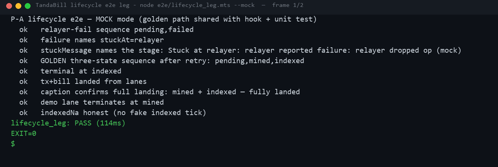

## Demo — bill lifecycle, end-to-end

Frames: [1](docs/demo/lifecycle-leg_01.png) · [2](docs/demo/lifecycle-leg_02.png)

A real run of this repo's own e2e leg (`node e2e/lifecycle_leg.mts --mock`, Node 26) driving the **shipped**
`src/lib/userOpStatus.ts` — the exact module the client hook wraps — through the golden path
`pending → mined → indexed`, plus relayer-failure → retry recovery and the honest `indexedNa` guard.
Only the two external lanes (World relayer, indexer) are stubbed, behind the app's real proxy paths.
The same leg runs in CI on every push (`ci.yml` step “P-A lifecycle e2e”). Raw transcript + provenance:
[`docs/demo/PROVENANCE.md`](docs/demo/PROVENANCE.md).

## Create a Mini App

[Mini apps](https://docs.worldcoin.org/mini-apps) enable third-party developers to create native-like applications within World App.

This template is a way for you to quickly get started with authentication and examples of some of the trickier commands.

## Getting Started

1. `cp .env.sample .env.local`
2. Follow the instructions in the .env.local file
3. Run `npm install`
4. Run `npm run dev`
5. Run `ngrok http 3000`
6. Set `AUTH_SECRET` in the `.env.local` file to a secure random value, for example with `openssl rand -base64 32`.
7. [For Testing] If you're using a proxy like ngrok, update `AUTH_URL` in the `.env.local` file to your ngrok URL.
8. Continue to developer.worldcoin.org and make sure your app is connected to the right ngrok url
9. [Optional] For Verify and Send Transaction to work you need to do some more setup in the dev portal. The steps are outlined in the respective component files.

## Authentication

This starter kit uses [Minikit's](https://github.com/worldcoin/minikit-js) wallet auth to authenticate users, and [next-auth](https://authjs.dev/getting-started) to manage sessions.

## UI Library

This starter kit uses [Mini Apps UI Kit](https://github.com/worldcoin/mini-apps-ui-kit) to style the app. We recommend using the UI kit to make sure you are compliant with [World App's design system](https://docs.world.org/mini-apps/design/app-guidelines).

## Eruda

[Eruda](https://github.com/liriliri/eruda) is a tool that allows you to inspect the console while building as a mini app. You should disable this in production.

## Contributing

This template was made with help from the amazing [supercorp-ai](https://github.com/supercorp-ai) team.
